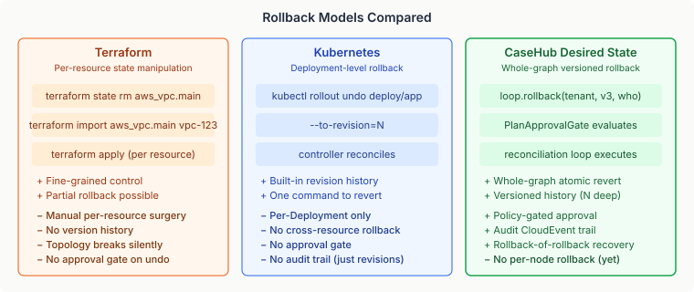

# Rollback in Reconciliation Loops — What Terraform and Kubernetes Get Wrong

Every system that manages desired state has the same problem: what happens when the desired state is wrong? The graph you declared — the one the reconciliation loop is diligently converging toward — turns out to be the problem, not the solution. Infrastructure is degraded, services are misconfigured, resources are in states nobody intended. You need to go back.

The surprising thing is how badly the dominant tools handle this. Terraform has no undo. Kubernetes has `kubectl rollout undo`, but only for individual Deployments. Neither treats rollback as a first-class operation across an entire desired-state topology. And neither gates the undo through the same approval mechanisms that gate forward changes.

## 1. The Terraform Trap: Per-Resource Surgery Without a Safety Net

Terraform's state model stores the current state of every managed resource, but not previous states. There is no `terraform rollback`. When a bad `apply` lands, recovery is manual: `terraform state rm` the broken resources, `terraform import` the correct ones, rewrite the HCL, re-apply. For a topology with thirty interdependent resources, this is surgery without anaesthesia.

The deeper issue is that Terraform doesn't understand topology as a first-class concept. Resources have dependencies declared via `depends_on` and implicit reference chains, but the state file is a flat list. When you manipulate individual resources, you're responsible for maintaining the dependency invariants yourself. Roll back a VPC without rolling back the subnets that reference it, and you get dangling references that `terraform plan` won't catch until the next apply fails.

**The missing abstraction is the graph.** Terraform operates on resources. Recovery needs to operate on the topology — the entire graph of interdependent resources — atomically.

## 2. The Kubernetes Limitation: Rollback Without Topology Awareness

Kubernetes does better. `kubectl rollout undo deployment/myapp --to-revision=3` reverts a Deployment to a previous revision, and the controller reconciles. This is real rollback — versioned, one-command, reconciliation-driven.

But it stops at the Deployment boundary. A production change that modifies a Deployment, a ConfigMap, a Service, and an Ingress — four resources that must change together — can only be rolled back one resource at a time. There is no "revert everything that changed in this release." Helm has `helm rollback`, which gets closer by reverting an entire release, but it operates on the rendered manifests, not the live cluster state. If someone modified a resource outside Helm, the rollback overwrites those changes silently.

And neither Kubernetes nor Helm gates rollback through an approval workflow. `kubectl rollout undo` executes immediately. In regulated environments — banking, healthcare, compliance-driven infrastructure — an unreviewed undo is as dangerous as an unreviewed deploy.

## 3. What Rollback Actually Requires

I think there are five properties a rollback mechanism needs to be genuinely useful in production. Not all tools need all five, but the gap between what exists today and what production systems demand is wider than most people assume.

**Whole-graph atomicity.** Rollback operates on the entire desired-state graph — all nodes, all dependencies, all ordering constraints. Not per-resource, not per-deployment. The graph was declared as a unit; it should be reverted as a unit.

**Versioned history.** The system stores N previous graph versions, not just "current" and "last." An operator can list versions, inspect what each contained, and choose which to revert to. History is append-only and tracks who made each change and why.

**Approval-gated execution.** Rollback generates a plan — a diff between the target historical graph and the current actual state — and routes it through the same approval mechanism that gates forward changes. Emergency rollback auto-approves via policy; non-critical rollback requires review. The policy decides, not the operator's muscle memory.

**Audit trail.** Every rollback emits a structured event — who initiated it, what version they reverted from and to, and a correlation ID that links the rollback intent to the subsequent plan approval or rejection. Monitoring systems can track the full lifecycle without scraping logs.

**Recovery from rejected rollback.** If the approval policy rejects the rollback plan, the operator needs a path back. The pre-rollback graph is in history. The rollback itself is recorded as a new version. Rollback-of-rollback is always available.

## 4. How CaseHub's Desired-State Runtime Handles This

The approach I took in CaseHub's reconciliation runtime is graph-level rollback through the existing reconciliation loop. No new execution path — the rollback swaps the desired graph, and the normal planner, approval gate, and executor handle the rest.

The `DesiredStateHistoryStore` is an append-only version log per tenant. Every call to `updateDesired()` records the new graph with a monotonically increasing version number. Lifecycle phase transitions and internal fault-policy mutations are excluded — they're system behaviour, not operator intent. The history depth is configurable; the default is ten versions.

`ReconciliationLoop.rollback(tenancyId, version, initiatedBy)` loads a historical graph, cancels any pending approval and any active lifecycle, emits a `ROLLBACK_INITIATED` CloudEvent, and atomically swaps the desired state. The next reconciliation cycle picks it up: the `TransitionPlanner` diffs the historical desired graph against actual state, produces a `TransitionPlan` with additions and removals, and feeds it to the `PlanApprovalGate`.

The gate receives a `PlanContext.Rollback` — a sealed type that carries the source and target version numbers, a correlation UUID, and a reason string. `PlanApprovalPolicy` implementations can pattern-match on this to apply different rules: auto-approve for emergency rollback, gate for non-critical changes. The same policy interface handles both forward plans and rollback plans, with full context about what kind of operation is being evaluated.

## 5. The Design Decisions That Mattered

Two decisions shaped this more than the implementation itself.

**History captures intent, not mechanics.** The reconciliation loop calls `compareAndSetDesired()` for lifecycle phase transitions and for internal fault-policy CAS retries. Both are legitimate graph mutations, but neither is operator intent. Recording them would fill the history with system housekeeping — a five-phase lifecycle would consume half the default history depth on its own. The operator who needs to roll back wants to revert their last change, not the runtime's last phase advance.

**Rollback cancels lifecycle.** When a tenant is mid-lifecycle — phase 2 of 3, say — and rollback fires, the lifecycle is cancelled outright. The historical graph has no lifecycle metadata; it's a raw graph, not a phased compilation result. I considered preserving lifecycle context alongside the graph, but the complexity wasn't justified. Rollback is an operational recovery verb. The operator is choosing to abandon whatever is in progress and return to a known-good state. If they want the lifecycle back, they recompile.

## 6. What This Opens Up

Whole-graph rollback is a foundation, not a feature. With versioned history in place, the same store supports:

- **Diff inspection** — compare any two versions to see what changed, without executing anything
- **Time-travel debugging** — load a historical graph alongside current actual state to understand what the system was trying to converge toward when a failure occurred
- **Compliance audit** — who changed the desired state, when, and what was the state before and after — all queryable from the history store without log archaeology

Per-node rollback is the obvious next step. The history store already contains full graph snapshots, so extracting a single node's historical spec is a lookup, not a new storage axis. The runtime can apply it as a `GraphMutation.UpdateNode` through the existing `compareAndSetDesired()` path. The infrastructure is in place; the convenience API is a follow-on.

The deeper question is whether the industry will converge on graph-level rollback as the standard, or whether per-resource state manipulation will remain the norm. Terraform's dominance normalised the idea that recovery is the operator's problem. Kubernetes improved on this for individual resources but stopped at the topology boundary. The gap — atomic, audited, approval-gated rollback across an entire desired-state graph — is where the next generation of infrastructure management needs to go.
