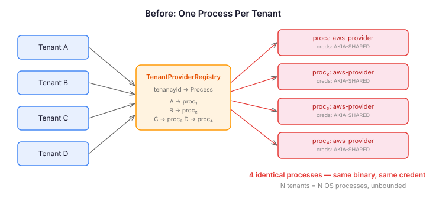
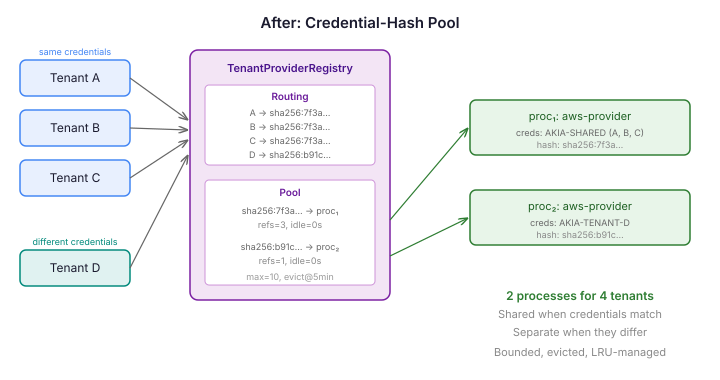

# The Pool Key That Was Already There

Terraform providers are stateful processes. You start a Go binary, complete a gRPC handshake, call `ConfigureProvider` with credentials, and from that point on the process holds those credentials in memory for its lifetime. There is no `ReconfigureProvider` RPC. There is no way to swap credentials without killing the process and starting a new one.

This is fine when you're Terraform CLI running one plan at a time. It's a problem when you're a desired-state runtime managing infrastructure across tenants.

## The Problem With One Process Per Tenant

The first version of the Terraform bridge in CaseHub used a straightforward model: `TenantProviderRegistry` held a `ConcurrentHashMap<String, ProviderProcessManager>` keyed by tenant ID. Each tenant got its own OS process. Clean isolation. No credential leakage between tenants.



The issue is arithmetic. If you have 50 tenants using the AWS provider, you have 50 identical Go processes running — same binary, same credentials, same configuration. Each process spawns its own gRPC channel, its own Netty EventLoopGroup, its own set of threads. The `ConcurrentHashMap` grows monotonically. There's no idle eviction. No upper bound. No sharing.

The credential resolver in CaseHub's platform layer isn't tenant-aware — `CredentialResolver.resolve(credentialRef)` takes a logical name and returns a static credential map. Every tenant hitting the same `credentialRef` gets the same `access_key` and `secret_key`. Fifty tenants, fifty identical processes doing identical work.

## The Key Was Always the Credentials

The fix was hiding in the data flow. We were already resolving credentials before configuring the provider. The credential map was right there — we just weren't using it as an identity.

SHA-256 the sorted entries of the resolved credential map. That hash becomes the pool key. Tenants with identical credentials produce the same hash and share a process. Tenants with different credentials produce different hashes and get separate processes. The pool key is an identity function over provider configuration — it doesn't need to know whether credentials are shared or per-tenant. It just hashes what it gets.

```java
static String hash(Map<String, String> credentials) {
    if (credentials == null || credentials.isEmpty()) {
        return UNCONFIGURED;
    }
    MessageDigest digest = MessageDigest.getInstance("SHA-256");
    new TreeMap<>(credentials).forEach((k, v) -> {
        digest.update(k.getBytes(UTF_8));
        digest.update((byte) '=');
        digest.update(v.getBytes(UTF_8));
        digest.update((byte) '\n');
    });
    return bytesToHex(digest.digest());
}
```

The `TreeMap` sorts lexicographically. Two maps with the same entries in different iteration order produce the same hash. The sentinel `UNCONFIGURED` handles the no-credentials case — all tenants sharing an unconfigured provider share one process.

## Two Levels, Not One

`TenantProviderRegistry` evolved from a flat map to a two-level structure:

1. **Pool** — `ConcurrentHashMap<String, PoolEntry>` keyed by config hash. Each entry wraps a `ProviderProcessManager` with a reference count, a last-access timestamp, and the hash itself.

2. **Routing** — `ConcurrentHashMap<String, String>` mapping `tenancyId → configHash`. The indirection that makes sharing work.



When `getProtocol(tenancyId)` is called: resolve credentials, compute hash, check the routing table. If the tenant is already routed to the right hash, touch the pool entry's timestamp and return the cached protocol. If the hash changed (credential rotation), remove the old routing entry, decrement the old ref count, and route to the new hash — creating a new process if needed.

The ref count is the load-bearing part. A pool entry with three tenants routed to it has `refCount=3`. When a tenant is evicted (auth retry, credential rotation), the ref count drops but the process stays alive for the remaining tenants. The process only becomes eligible for cleanup when `refCount` hits zero.

## Idle Eviction and Pool Bounds

A `ScheduledExecutorService` runs every 30 seconds and checks: is `refCount == 0` AND has the entry been idle longer than `idleTimeout`? If both, shut down the process and remove it from the pool.

Max pool size is enforced at creation time. When the pool is full and a new hash needs a process, the registry finds the least-recently-used entry with zero refs and evicts it. If every entry has active tenants — all processes are in use by at least one tenant — the registry blocks up to `checkoutTimeout` before throwing `ProviderPoolExhaustedException`.

The configuration sits in the bridge YAML manifest:

```yaml
bridge:
  protocol: terraform
  lifecycle:
    mode: managed-process
    binaryPath: /opt/providers/terraform-provider-aws
    pool:
      maxProcesses: 10
      idleTimeout: 5m
      checkoutTimeout: 30s
```

When `pool:` is omitted, defaults apply. There is no "unpooled" mode — the pool is always active. The previous single-tenant behavior is simply `maxProcesses: unlimited, idleTimeout: never`, which is the degenerate case.

## Auth Retry With Shared Processes

The previous `evict(tenancyId)` killed the process. That's wrong when other tenants are using it.

The new `evict` removes the tenant's routing entry and decrements the ref count. That's all. No shutdown. The next `getProtocol` call for that tenant re-resolves credentials and computes a fresh hash. If the credentials rotated, the new hash routes to a different process. If they didn't change, the tenant routes back to the same process — and the auth error propagates as a genuine provider rejection, not a stale credential.

This is the right failure mode. One failed request per credential rotation event is acceptable. The alternative — proactive TTL-based refresh — adds timer management complexity for a marginal latency improvement.

## Why This Matters Beyond CaseHub

Every infrastructure runtime that manages external tool processes faces this problem. Terraform, Ansible, Pulumi, Crossplane — any system that orchestrates tool binaries across tenants must decide: one process per tenant (simple but wasteful), one shared process (efficient but credential isolation is lost), or something in between.

The credential-hash pool is the "something in between." It's a general pattern: hash the configuration that makes processes non-interchangeable, and pool everything else. Two tenants with the same AWS account share a process. Two tenants with different accounts don't. The pool key encodes exactly the right granularity of isolation.

The key insight — and the reason I called this entry "the pool key that was already there" — is that the identity function was already in the data flow. The credentials were being resolved and passed to `configure()`. Nobody was hashing them. Adding a SHA-256 call and using the hash as a map key turned an O(N) process count into an O(distinct-configurations) process count. The pool machinery (eviction, bounds, ref counting) is standard. The pool key is the insight.
