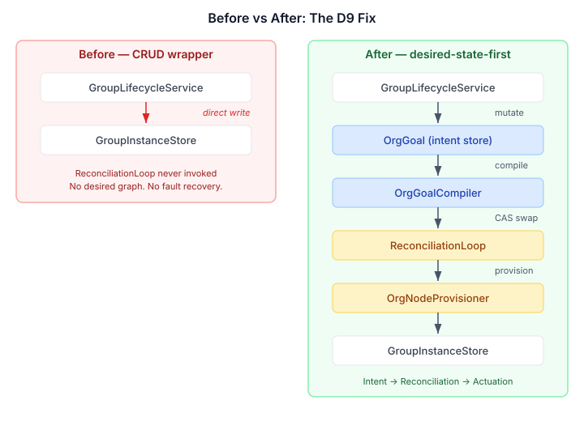
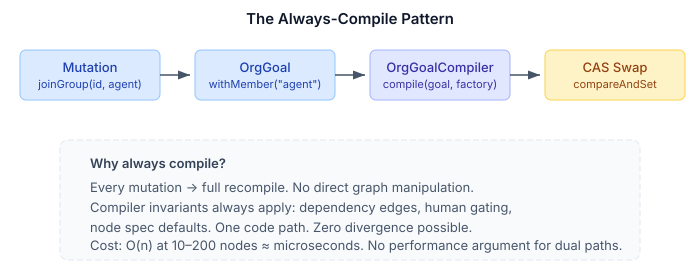

# The CRUD Wrapper That Bypassed Its Own Loop

When we built the eidos reconciliation bridge — the code that treats organisational structure as desired-state infrastructure — I thought the hard part was the mapping. Compiling `OrganizationalUnit` specs into graph nodes. Reading actual state from `GroupInstanceStore`. Wiring drift policies and fault escalation. That work landed, the tests passed, and the bridge existed.

Then Claude ran a decision review on the hardening spec and identified something I should have caught: the `DesiredStateGroupLifecycleService` we'd built was a CRUD wrapper. Every mutation — `createGroup`, `joinGroup`, `adoptRole`, `dissolveGroup` — wrote directly to `GroupInstanceStore.save()`. The desired-state graph was never touched. The reconciliation loop was never invoked. The very infrastructure this service was supposed to bridge was completely bypassed.

The spec called this the D9 violation. §6.1 of the society design spec is explicit: every `GroupLifecycleService` mutation updates the desired-state graph BEFORE updating `GroupInstance`. The service we shipped did neither.

## What D9 Actually Requires

The fix is not "add a graph write before the store write." That would be two sources of truth — the graph says one thing, the store says another, and they drift apart within a cycle.

D9 requires a clean separation between intent and actuality:

1. The caller declares what should be (by mutating the desired graph)
2. The reconciliation loop detects the delta between desired and actual
3. The provisioner makes reality match the declaration

The caller never writes to the store. Only the provisioner does, driven by reconciliation. This is the same pattern that makes Kubernetes work — `kubectl apply` writes the desired spec, the controller reconciles, the kubelet provisions. Nobody calls the kubelet directly.

## OrgGoal — The Intent Store

The first design decision was how mutations reach the desired graph. I initially proposed a hybrid: direct graph mutation for the fast path, periodic recompilation from `OrgGoalCompiler` as a consistency safety net.

Claude's decision review dismantled this in two moves. First: recompiling from `OrgRegistry` inverts the desired-state data flow. `OrgRegistry` is actual state — it's populated by provisioning. Recompiling desired state from actual state means you're deriving intent from reality. That's `terraform import` on every cycle — the plan becomes a mirror of what exists, not a declaration of what should exist.

Second: the hybrid approach is premature complexity. `OrgGoalCompiler` iterates units and relationships, creating a `DesiredNode` per entity. At 10–200 nodes per tenant, this is microseconds. There is no performance argument for maintaining two code paths that will inevitably diverge.

The result: always compile. Every mutation goes through `OrgGoal` (the intent store), then `OrgGoalCompiler`, then a CAS swap into `ReconciliationLoop`.

`OrgGoal` is an immutable record with copy-on-write mutation methods — `withUnitGoal()`, `withoutUnit()`, `withRelationship()`. Each mutation returns a new instance. No shared mutable state, no locking needed at the goal level. Concurrency is handled by the CAS swap at the reconciliation loop level: read current graph, compile new graph, `compareAndSetDesired(expected, new)`. If a concurrent mutation wins the race, re-read, re-apply, re-compile, retry. Bounded at three attempts.

The OrgGoal store is persisted only after a successful CAS — never before. This eliminates the window where concurrent readers see intermediate state. A crash between CAS success and store persistence is safe: the desired graph (in the reconciliation loop) is authoritative, and the goal store reconstructs from it on restart.

## Instance-Level Desired State

Structural mutations — creating groups, dissolving them, changing topology — map naturally to adding and removing nodes in the desired graph. But what about instance-level mutations like `joinGroup` and `adoptRole`? These change the internal state of an already-provisioned group, not its existence.

The answer: extend the node spec. `OrgUnitNodeSpec` now carries `desiredMembers`, `desiredRoles`, and `desiredMissions` alongside the `OrganizationalUnit` structural spec. `OrgUnitGoal` mirrors this with copy-on-write methods: `withMember("agent-1")`, `withRole(new DesiredRoleAdoption("agent-1", "leader"))`, `withoutMissionByName("deploy")`.

When `joinGroup("team-1", "agent-1", "t1")` is called, the `OrgUnitGoal` for `team-1` gets a new desired member. The compiler produces an `OrgUnitNodeSpec` with that member in its desired state. The CAS swap updates the desired graph. The reconciliation loop will eventually see the delta and the provisioner will update the `GroupInstance` with the new member.

"Eventually" is the key word. After `joinGroup` returns, the member is in the desired graph but not in the store. Callers who query `findInstance()` immediately get stale data. This is the fire-and-forget model — mutations declare intent, events announce reality. If you need synchronous confirmation, you're fighting the architecture.

## Constraint Enforcement at the Intent Boundary

With the desired-state-first pattern in place, validation moves too. The old code validated against `GroupInstanceStore` — checking actual state. The new code validates against `OrgGoal` — checking desired state.

This matters because the validation is now answering the right question. "Can this agent adopt this role?" is not about what exists in the store — it's about what the caller intends. If two concurrent callers both try to adopt the last available slot for a role, the first CAS wins and the second retries against the updated goal. The validation runs against the intended state at each attempt, not against a potentially stale store.

The constraints are straightforward:

| Constraint | Where checked | What happens |
|---|---|---|
| `RoleSpec.maxCardinality` | `adoptRole` | Count desired roles by name; reject at capacity |
| `RoleSpec.incompatibleWith` | `adoptRole` | Cross-check agent's current desired roles |
| Unknown role | `adoptRole` | Role must exist in `OrganizationalUnit.roleSpecs()` |
| `FormationRules.maxGroupSize` | `joinGroup` | Count desired members; reject at limit |
| `MAX_MEMBERS` (50) | `joinGroup` | Hard cap from `OrganizationalUnit` |
| `FormationRules.allowedPaths` | `createGroup` | Map `FormationOrigin` to `FormationPath`; reject if not in set |

Each constraint is a precondition on the `OrgGoal` mutation — checked inside the lambda before the copy-on-write method is called. If validation fails, no mutation happens, no compilation runs, no CAS is attempted.

## Lifecycle Events

The third piece: making mutations observable. `GroupLifecycleListener` has nine callback methods — `onFormationProposal`, `onDissolution`, `onMemberJoined`, `onRoleAdoption`, `onTopologyChange`, and so on. None of them were being fired.

Events now fire after the `OrgGoal` mutation succeeds. This means they announce intent, not actuality — `onMemberJoined` fires when the desired graph is updated, not when the provisioner has written to the store. Callers who observe events are observing the declaration, not the reconciliation. The provisioner fires its own CloudEvents through the reconciliation event emitter when the actuation happens.

This is a deliberate split. Intent events are synchronous (same thread as the mutation). Actuation events are asynchronous (fired by the reconciliation loop on its scheduler thread). Different consumers care about different things.

## What This Opens Up

The D9 fix is not an isolated refactoring. It is the foundation for the rest of the society hardening epic. With the desired-state-first pattern in place:

- **Constraint enforcement** validates against intent, not stale state. Concurrent mutations resolve correctly through CAS.
- **Fault recovery** works through the existing reconciliation infrastructure. If a group's provisioning fails three times, `OrgFaultPolicy` escalates — first to an automated review node, then to a human. No special-case code for org faults.
- **Drift detection** compares desired members/roles/missions against actual. A member who departs is drift — the reconciliation loop can detect it and re-provision.
- **Emergence promotion** can flow through the same path. When `EmergencePromotionListener` detects a swarm team stabilising, it calls `createGroup` — which writes to the desired graph, which triggers reconciliation, which provisions the group. No bypassing.

The org domain is now on the same footing as every other desired-state domain. The provisioner provisions. The adapter reads actual state. The planner plans transitions. The loop converges. The only things that are domain-specific are the node specs and the provisioner implementation — exactly as the SPI architecture intended.
